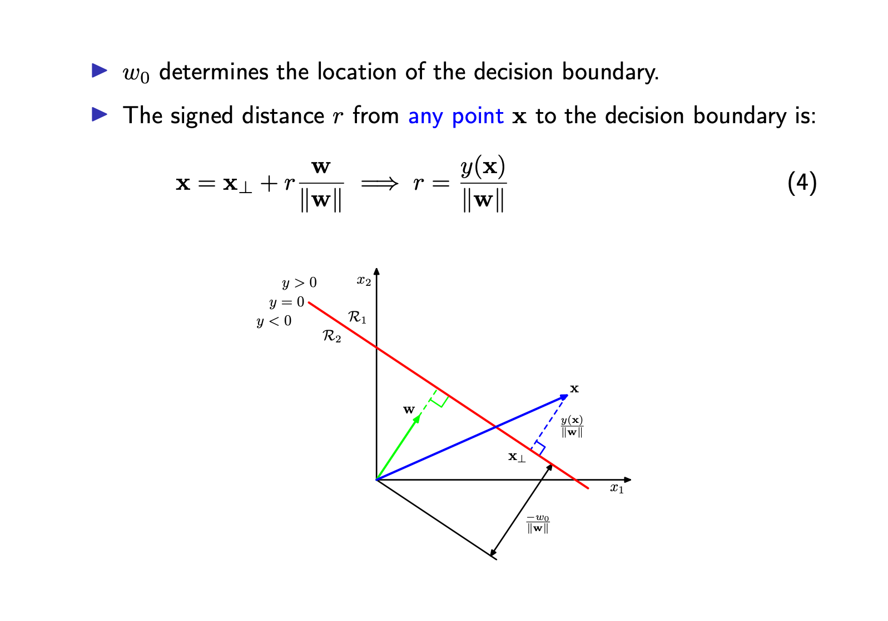
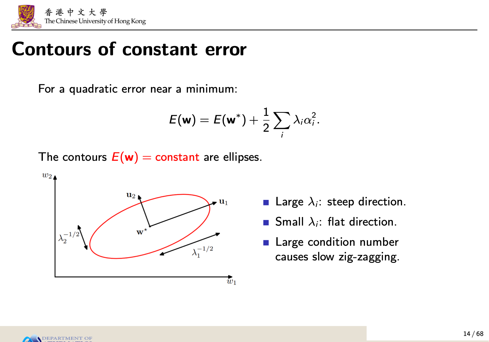
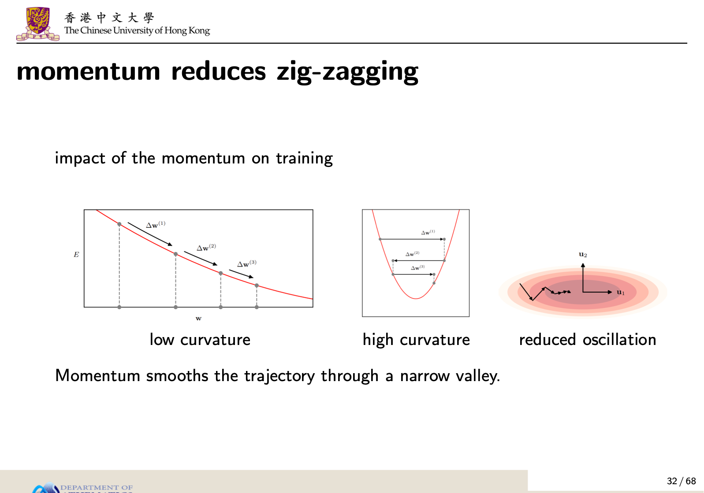

# AI4S5000 后三章知识速通：模块 4–6

> **适用范围**：已完成 HW1、HW2，以及 Lecture 1–3 的复习。本文只覆盖 **Lecture 4、5、6**，并补上模块 4 对应的 HW3 标准题，以及新 HW4 的 **Q1、Q2**（Q3 编程题不展开）。
>
> **使用方式**：先看第 0 节路线图；每个模块先读“必会”，再做例题，最后用自测检查。考场上遇到计算题，直接套第 7、8 节的模板。
>
> 模块 1–3 的工具会反复用到：Hessian/特征值用于模块 6；Gaussian MLE 与平方误差用于模块 5、6；Bayes 用于模块 4 的后验与 LDA。本文不再重复这些基础。

---

## 0. 先看路线图

| 模块 | 核心问题 | 必须会做的动作 | 对应题目 |
|---|---|---|---|
| **模块 4** 线性分类、决策、评价 | 怎样画边界、算距离、做决策、比较分类器？ | 写判别函数；求单位法向量与有符号距离；用损失矩阵定阈值；从混淆矩阵算指标 | HW3 Q1、Q3、Q4 |
| **模块 5** 深度网络、激活、损失 | 网络怎样前向计算？不同任务怎样选输出与损失？ | 矩阵维度检查；手算前向传播；默写任务—激活—损失表 | HW3 Q2（加练）；概念题 |
| **模块 6** 损失曲面与梯度下降 | 怎样从数据写损失、求梯度/Hessian、更新参数、判断收敛？ | 写损失；求梯度与 Hessian；手算 GD/SGD/momentum；给稳定学习率范围 | HW4 Q1、Q2 |

### 如果只剩 2 小时

优先顺序：

1. **4.2 线性边界与距离**（HW3 Q1）
2. **4.4 损失矩阵与阈值**（HW3 Q3）
3. **4.5 混淆矩阵与指标**（HW3 Q4）
4. **5.5 任务—激活—损失表**（必背）
5. **6.1–6.3 损失、Hessian、GD、稳定步长**
6. **7. HW4 Q1–Q2 全部手算一遍**

### 已学工具在本篇的复用

| 已学内容 | 在后三章怎么用 |
|---|---|
| 向量范数、内积、正交 | 分类边界的单位法向量、点到边界距离 |
| 特征值、Hessian | 判断驻点类型；解释损失曲面曲率与收敛 |
| Gaussian MLE | 回归为什么用平方误差；分类为什么用交叉熵 |
| Bayes 公式 | 后验概率、LDA、最小误分类决策 |
| 平方误差、正则化 | 模块 6 的损失函数与梯度下降 |

---

# 模块 4：线性分类、决策与评价

> 对应 Lecture 4，重点 pp.6–29。

## 4.1 三条分类路线

| 方法 | 学什么 | 是否给后验概率 | 特点 |
|---|---|---|---|
| **判别函数** discriminant function | 直接学 $f(x)\to$ 类别 | 否 | 最简单；不能直接做风险调整、拒绝选项 |
| **生成式模型** generative | 学 $p(x\mid C_k)$ 和先验 $p(C_k)$，再用 Bayes 得 $p(C_k\mid x)$ | 是 | 需要更多数据；可以生成样本；假设较强 |
| **判别式模型** discriminative | 直接学 $p(C_k\mid x)$ | 是 | 参数通常更少；分类性能往往更好 |

必须会说：

- 知道后验概率 $p(C_k\mid x)$ 的好处：
  1. 损失矩阵改变时可立即调整决策；
  2. 可以做拒绝选项；
  3. 可以补偿类别先验；
  4. 可以融合多个模型/多个来源的概率。
- 判别函数只给类别，不一定给概率；生成式与判别式都给概率，但学习对象不同。

---

## 4.2 二分类线性判别与几何（HW3 Q1）

> Lecture 4 pp.6–8。

### 基本公式

线性判别函数：

$$
y(x)=w^Tx+w_0.
$$

加入哑输入 $x_0=1$，令

$$
\tilde w=(w_0,w^T)^T,\qquad \tilde x=(1,x^T)^T,
$$

则

$$
y(x)=\tilde w^T\tilde x.
$$

决策规则：

$$
y(x)\ge 0\Rightarrow C_1,\qquad y(x)<0\Rightarrow C_2.
$$

决策边界：

$$
w^Tx+w_0=0.
$$

在 $D$ 维输入空间中，这是一个 $(D-1)$ 维超平面。

### 几何意义

- $w$ 与决策边界**正交**，决定边界的**方向**；
- $w_0$ 决定边界的**位置**；
- 单位法向量：

$$
\hat n=\frac{w}{\|w\|}.
$$

- 任意点 $x$ 到边界的有符号距离：

$$
r(x)=\frac{y(x)}{\|w\|}=\frac{w^Tx+w_0}{\|w\|}.
$$

推导：把 $x$ 分解为

$$
x=x_\perp+r\hat n,
$$

其中 $x_\perp$ 在边界上，则

$$
y(x)=w^T(x_\perp+r\hat n)+w_0=0+r\|w\|.
$$



> 图：Lecture 4 p.8。注意 $w$ 指向 $y>0$ 的一侧；边界沿法线方向的截距是 $-w_0/\|w\|$。

### 最容易错的符号

| 量 | 公式 | 含义 |
|---|---|---|
| 边界沿法线方向的截距 | $-w_0/\|w\|$ | 从原点到边界的“边界位置坐标” |
| 原点作为样本点的有符号距离 | $r(0)=+w_0/\|w\|$ | 把 $x=0$ 代入 $r(x)=y(x)/\|w\|$ |

两者相差一个负号，因为方向定义相反。**题目问“原点到边界的距离”时，先看它要的是无符号距离还是有符号距离；有符号距离要说明正方向。**

无符号距离：

$$
d(x)=|r(x)|=\frac{|w^Tx+w_0|}{\|w\|}.
$$

### HW3 Q1 标准解答

题目：

$$
w=\begin{pmatrix}-3\\4\end{pmatrix},\qquad w_0=2.
$$

#### (a) 边界方程、作图、单位法向量

边界：

$$
y(x)=-3x_1+4x_2+2=0.
$$

解出 $x_2$：

$$
4x_2=3x_1-2
\quad\Rightarrow\quad
x_2=\frac34x_1-\frac12.
$$

作图用两个截距：

$$
x_1=0\Rightarrow x_2=-\frac12,
\qquad
x_2=0\Rightarrow x_1=\frac23.
$$

所以边界过

$$
(0,-1/2),\qquad (2/3,0).
$$

法向量范数：

$$
\|w\|=\sqrt{(-3)^2+4^2}=5.
$$

单位法向量：

$$
\hat n=\frac{w}{\|w\|}
=\begin{pmatrix}-3/5\\[2pt]4/5\end{pmatrix}.
$$

#### (b) 原点的有符号距离与类别

$$
y(0)=2\ge 0 \Rightarrow C_1.
$$

即原点属于 $C_1$。

有符号距离：

$$
r(0)=\frac{y(0)}{\|w\|}=\frac25.
$$

注意：边界沿法线方向的截距是

$$
-\frac{w_0}{\|w\|}=-\frac25,
$$

不要和 $r(0)=+2/5$ 混淆。

#### (c) 测试点 $x_A=(2,-1)^T$

判别值：

$$
y(x_A)=-3(2)+4(-1)+2=-6-4+2=-8<0.
$$

所以

$$
x_A\in C_2.
$$

有符号距离：

$$
r_A=\frac{y(x_A)}{\|w\|}=-\frac85.
$$

无符号距离：

$$
d_A=\frac85.
$$

### 考场步骤

1. 写 $y(x)=w^Tx+w_0$；
2. 写边界方程，必要时解出 $x_2$ 画图；
3. 算 $\|w\|$ 和单位法向量；
4. 代入判别值判类别；
5. 再用 $r=y/\|w\|$ 求距离，注意符号。

---

## 4.3 多类分类、one-hot、最小二乘分类

> Lecture 4 pp.9–13。

### 多类线性判别

不要用“一对多”或“一对一”硬拼，因为可能出现无法判定或区域重叠。标准做法是每类一个线性函数：

$$
y_k(x)=w_k^Tx+w_{k0},\qquad k=1,\dots,K.
$$

判别规则：

$$
x\in C_k
\quad\Longleftrightarrow\quad
y_k(x)>y_j(x)\quad \forall j\ne k.
$$

类别 $k$ 与 $j$ 的边界：

$$
y_k(x)=y_j(x),
$$

即

$$
(w_k-w_j)^Tx+(w_{k0}-w_{j0})=0.
$$

它仍是线性边界。

### One-hot 编码

$K$ 类标签用 $K$ 维向量表示：

$$
t=(0,\dots,0,1,0,\dots,0)^T,
$$

真实类别位置为 1，其余为 0。例如 $K=5$，第 2 类：

$$
t=(0,1,0,0,0)^T.
$$

重要解释：

$$
E[t_k\mid x]=p(C_k\mid x).
$$

也就是说，one-hot 的每个分量是“该样本属于该类的经验概率”（0 或 1），其期望是后验概率。

### 最小二乘用于分类的局限

技术上可以对 one-hot 目标做最小二乘，得到闭式解：

$$
y_k(x)=w_k^Tx+w_{k0},
\qquad
y(x)=\tilde W^T\tilde x.
$$

但通常不这样做，原因：

1. **输出不是概率**：线性模型的输出不受 $[0,1]$ 约束，不能解释为概率；
2. **对离群点敏感**：最小二乘对应 Gaussian 噪声假设，而二分类目标显然不是 Gaussian；
3. **不是最大似然**：二分类更适合 Bernoulli + sigmoid + 交叉熵。

结论：最小二乘可以“算”，但不是分类的推荐方法。

---

## 4.4 决策论：误分类率、损失矩阵、拒绝选项

> Lecture 4 pp.14–23。

### 推断与决策

分类分两步：

1. **推断** inference：估计 $p(x,C_k)$ 或 $p(C_k\mid x)$；
2. **决策** decision：根据概率和损失做类别分配。

### 最小误分类率

二分类时，误分类概率：

$$
p(\text{mistake})
=
\int_{\mathcal R_1}p(x,C_2)\,dx
+
\int_{\mathcal R_2}p(x,C_1)\,dx.
$$

要让错误最小，应把 $x$ 分到后验概率最大的类：

$$
x\in C_1
\quad\Longleftrightarrow\quad
p(C_1\mid x)>p(C_2\mid x).
$$

等价地，比较 $p(x,C_1)$ 与 $p(x,C_2)$。

### 损失矩阵

定义 $L_{kj}$ 为：真实类别为 $C_k$、预测为 $C_j$ 时的损失。

注意下标顺序：**先真实，后预测**。

给定 $x$，选择类别 $j$ 的条件风险：

$$
R(j\mid x)=\sum_k L_{kj}p(C_k\mid x).
$$

最优决策：

$$
j^\star=\arg\min_j R(j\mid x)
$$

也就是“按列”计算后验加权损失，选最小的一列。

### 二分类阈值（HW3 Q3）

设

$$
L=
\begin{pmatrix}
0 & L_{12}\\
L_{21} & 0
\end{pmatrix},
\qquad
p=P(C_1\mid x).
$$

若预测 $C_1$：

$$
R(1)=L_{11}p+L_{21}(1-p)=L_{21}(1-p).
$$

若预测 $C_2$：

$$
R(2)=L_{12}p+L_{22}(1-p)=L_{12}p.
$$

选择 $C_1$ 当且仅当

$$
R(1)<R(2)
$$
$$
L_{21}(1-p)<L_{12}p
$$
$$
L_{21}<(L_{12}+L_{21})p
$$
$$
p>\frac{L_{21}}{L_{12}+L_{21}}
$$

若 $L_{12}=L_{21}$，则阈值为

$$
\frac{L_{21}}{L_{12}+L_{21}}=\frac12,
$$

退化为最小误分类率规则。

**解释**：

- $L_{21}$ 是“真实为 $C_2$，却预测 $C_1$”的损失（假阳性代价）；
- $L_{12}$ 是“真实为 $C_1$，却预测 $C_2$”的损失（假阴性代价）；
- 假阳性代价越大，阈值越高，越不容易判为 $C_1$。

### 0–1 损失与误分类率

若

$$
L_{kk}=0,\qquad L_{kj}=1\quad(k\ne j),
$$

则

$$
E[L]
=
\sum_{k\ne j}\int_{\mathcal R_j}p(x,C_k)\,dx
=
p(\text{mistake}).
$$

所以最小化 0–1 损失的期望损失 = 最小化误分类率。

### 拒绝选项

如果最大后验概率也不够大，可以拒绝自动决策：

$$
\max_k p(C_k\mid x)\le \theta.
$$

此时拒绝自动决策，交给人工。

- $\theta=1$：拒绝所有样本；
- $\theta<1/K$：不拒绝任何样本；
- 二分类时 $\theta<0.5$ 不拒绝。

### 先验补偿（拓展）

如果训练集是人为平衡的，而真实先验不同，可用：

$$
p(C_k\mid x)
\propto
p_{\text{train}}(C_k\mid x)
\frac{p_{\text{target}}(C_k)}{p_{\text{train}}(C_k)}.
$$

这是“知道后验概率”的一个实际好处。

---

## 4.5 评价指标：混淆矩阵、ROC、AUC（HW3 Q4）

> Lecture 4 pp.24–29。

### 混淆矩阵

先明确“正类”是谁。以“患病”为正类：

| 真实 \ 预测 | 预测负 | 预测正 |
|---|---:|---:|
| 真实负 | TN | FP |
| 真实正 | FN | TP |

- **TP**：真阳性，正确的阳性；
- **TN**：真阴性，正确的阴性；
- **FP**：假阳性（Type I error），健康被判有病；
- **FN**：假阴性（Type II error），有病被判健康。

### 核心指标

$$
\text{Accuracy}=\frac{TP+TN}{TP+FP+TN+FN}.
$$

$$
\text{Precision}=\frac{TP}{TP+FP}.
$$

$$
\text{Recall}=\text{Sensitivity}=\text{TPR}
=\frac{TP}{TP+FN}.
$$

$$
\text{Specificity}=\text{TNR}
=\frac{TN}{TN+FP}.
$$

$$
\text{FPR}=\frac{FP}{FP+TN}=1-\text{Specificity}.
$$

$$
\text{FNR}=\frac{FN}{TP+FN}=1-\text{Recall}.
$$

$$
\text{FDR}=\frac{FP}{FP+TP}.
$$

$$
F_1
=
\frac{2\cdot \text{Precision}\cdot \text{Recall}}
{\text{Precision}+\text{Recall}}
=
\frac{2TP}{2TP+FP+FN}.
$$

注意：

- **Precision** 问“报出的阳性中有多少是真的”；
- **Recall** 问“实际阳性中找回了多少”；
- **F1** 是调和平均，不是算术平均；
- F1 不包含 TN，因此在 TN 极大时不会被“假高准确率”掩盖。

### 类别不平衡与零分母

Accuracy 在不平衡数据上会误导。例如 1000 人中只有 1 个病人，全部判健康也有 99.9% 准确率。

零分母：

- Precision 的 $TP+FP=0$：数学上未定义；
- 若题目约定“置零”，则写 0，并说明是按约定；
- 不要不说明就自动写 0。

### HW3 Q4 标准解答

数据：

$$
N=100000,\qquad N_{\text{pos}}=100,\qquad N_{\text{neg}}=99900.
$$

正类为患病（$t=1$）。

#### 模型 A：全部预测健康

| 模型 A | 预测负 | 预测正 |
|---|---:|---:|
| 真实负 | TN=99900 | FP=0 |
| 真实正 | FN=100 | TP=0 |

$$
\text{Accuracy}=\frac{99900+0}{100000}=99.9\%.
$$

$$
\text{Precision}=\frac{0}{0+0}
\quad(\text{undefined}).
$$

按约定置 0 时写 0，并说明是按约定。

$$
\text{Recall}=\frac{0}{0+100}=0.
$$

$$
F_1=0.
$$

#### 模型 B

已知：

$$
TP=80,\qquad FN=20,\qquad FP=320.
$$

$$
TN=99900-320=99580.
$$

| 模型 B | 预测负 | 预测正 |
|---|---:|---:|
| 真实负 | TN=99580 | FP=320 |
| 真实正 | FN=20 | TP=80 |

$$
\text{Accuracy}
=
\frac{99580+80}{100000}
=
99.66\%.
$$

$$
\text{Precision}=\frac{80}{80+320}=20\%.
$$

$$
\text{Recall}=\frac{80}{80+20}=80\%.
$$

$$
F_1
=
\frac{2\cdot 0.2\cdot 0.8}{0.2+0.8}
=
32\%.
$$

#### 对比

| 模型 | Accuracy | Precision | Recall | F1 |
|---|---:|---:|---:|---:|
| A 全判健康 | **99.9%** | 未定义/0 | 0 | 0 |
| B 诊断模型 | 99.66% | 20% | **80%** | **32%** |

结论：

- A 的 Accuracy 更高，但一个病人都没找出来，实际无用；
- B 的 Accuracy 略低，但 Recall 和 F1 明显更好；
- 最终选择要结合“漏诊”和“误报”的实际代价，不能只看 Accuracy。

### ROC 与 AUC

ROC 曲线：

- 横轴：$\text{FPR}$；
- 纵轴：$\text{TPR}=\text{Recall}$；
- 同一模型，改变决策阈值得到不同点；
- $(0,0)$：全部判负；
- $(1,1)$：全部判正；
- $(0,1)$：完美分类；
- 对角线：随机猜测基线。

AUC：

- $0.5$：随机；
- $1$：完美分离；
- 可解释为“随机取一个正样本和一个负样本，正样本得分高于负样本的概率”（并列算 0.5）。

### 多类评价（拓展）

多类可对每个类做 one-vs-rest，得到每类的 Precision/Recall/F1，再取：

- **macro average**：各类指标先算再平均；
- **micro average**：先合并 TP/FP/FN 再算。

题目若没要求，通常说明按哪种类别为“正类”即可。

---

## 4.6 生成式与判别式：LDA、QDA、Logistic

> Lecture 4 pp.30–46。属于概念拓展，但很可能出选择/简答。

### LDA：共享协方差的高斯生成式模型

假设：

$$
p(x\mid C_k)=\mathcal N(x\mid \mu_k,\Sigma),
$$

两类共享同一个协方差 $\Sigma$。

后验：

$$
p(C_1\mid x)=\sigma(a(x)),
$$

其中

$$
a(x)=\ln\frac{p(x\mid C_1)p(C_1)}{p(x\mid C_2)p(C_2)}.
$$

代入高斯密度，二次项 $x^T\Sigma^{-1}x$ 相消，得到线性函数：

$$
a(x)=w^Tx+w_0,
$$

$$
w=\Sigma^{-1}(\mu_1-\mu_2),
$$

$$
w_0
=
-\frac12\mu_1^T\Sigma^{-1}\mu_1
+\frac12\mu_2^T\Sigma^{-1}\mu_2
+\ln\frac{p(C_1)}{p(C_2)}.
$$

所以决策边界是线性的，这就是 **Linear Discriminant Analysis (LDA)**。

MLE：

$$
\hat\pi=\frac{N_1}{N},
\qquad
\hat\mu_1=\frac1{N_1}\sum_{n\in C_1}x_n,
\qquad
\hat\mu_2=\frac1{N_2}\sum_{n\in C_2}x_n,
$$

$$
\hat\Sigma
=
\frac{N_1}{N}S_1+\frac{N_2}{N}S_2,
$$

其中 $S_k$ 是类内样本协方差。

### QDA：各自协方差

如果允许每类有自己的协方差 $\Sigma_k$，二次项不再相消，得到二次判别边界：

$$
\text{QDA}.
$$

一句话：**共享协方差 $\Rightarrow$ 线性边界；各自协方差 $\Rightarrow$ 二次边界。**

### Logistic 回归：判别式模型

直接建模后验：

$$
p(C_1\mid \phi)=y(\phi)=\sigma(w^T\phi),
\qquad
\sigma(a)=\frac1{1+e^{-a}}.
$$

负对数似然 = 二元交叉熵：

$$
E(w)
=
-\sum_{n=1}^N
\left[
t_n\ln y_n+(1-t_n)\ln(1-y_n)
\right].
$$

梯度：

$$
\nabla_w E(w)
=
\sum_{n=1}^N (y_n-t_n)\phi_n.
$$

要点：

- 没有闭式解；
- 损失函数是凸的；
- 线性可分时，无正则 MLE 会让 $\|w\|\to\infty$，sigmoid 变成硬阶跃，严重过拟合；
- 加 $L_2$ 正则可缓解。

### HW3 Q2 标准推导（加练）

#### (a) Sigmoid 导数

$$
\sigma(a)=\frac1{1+e^{-a}}.
$$

$$
\frac{d\sigma}{da}
=
\frac{e^{-a}}{(1+e^{-a})^2}
=
\frac1{1+e^{-a}}\cdot\frac{e^{-a}}{1+e^{-a}}
=
\sigma(a)(1-\sigma(a)).
$$

#### (b) 交叉熵梯度

$$
E(w)=-\sum_n\left[t_n\ln y_n+(1-t_n)\ln(1-y_n)\right],
\qquad y_n=\sigma(a_n),
\qquad a_n=w^T\phi_n.
$$

对单个样本：

$$
\frac{\partial E_n}{\partial a_n}
=
-\frac{t_n}{y_n}y_n(1-y_n)
+\frac{1-t_n}{1-y_n}y_n(1-y_n)
=
y_n-t_n.
$$

再由链式法则：

$$
\nabla_w E_n
=
\frac{\partial E_n}{\partial a_n}\phi_n
=
(y_n-t_n)\phi_n.
$$

所以

$$
\nabla_w E(w)
=
\sum_n (y_n-t_n)\phi_n.
$$

### 生成式 vs 判别式

| 对比 | 生成式 | 判别式 |
|---|---|---|
| 学什么 | $p(x\mid C_k)$, $p(C_k)$ | $p(C_k\mid x)$ |
| 例子 | LDA、QDA、朴素 Bayes | Logistic 回归、神经网络 |
| 数据需求 | 通常更多 | 通常更少 |
| 假设 | 强（如 Gaussian） | 较弱 |
| 优点 | 可生成、可处理缺失 | 分类性能往往更好 |
| 缺点 | 假设错时性能差 | 不给生成模型 |

---

## 4.7 模块 4 自测

1. 写出一维/二维线性判别函数的决策边界，并说明 $w$ 与 $w_0$ 的几何意义。
2. $w=(1,2)^T,w_0=-3$，求原点的有符号距离和类别。
3. 为什么 $r(0)=w_0/\|w\|$，而边界截距是 $-w_0/\|w\|$？
4. 写出损失矩阵下的最优决策规则，并推导二分类阈值。
5. 给一个类别不平衡例子，说明 Accuracy 为什么会骗人。
6. Precision 与 Recall 的分母分别是什么？
7. ROC 的横纵轴是什么？AUC=0.5 意味着什么？
8. LDA 与 QDA 的边界形状为什么不同？
9. Logistic 回归的梯度是什么？为什么线性可分时会过拟合？

---

# 模块 5：深度网络、激活函数与损失函数

> 对应 Lecture 5，重点 pp.23–70。

## 5.1 为什么需要学习特征

> Lecture 5 pp.4–22。

固定基函数模型：

$$
y(x,w)=f\left(w_0+\sum_{j=1}^M w_j\phi_j(x)\right).
$$

- $\phi_j(x)$ 是人工选定的特征；
- 只学习系数 $w_j$；
- 问题：**在看到数据之前，怎么知道该选哪些特征？**

### 维数灾难

- 一维三次多项式有 4 个系数；
- $D$ 维输入的三次多项式需要交互项 $x_ix_j$、$x_ix_jx_k$；
- 总次数不超过 $M$ 的单项式数量约为

$$
\binom{D+M}{M}=O(D^M).
$$

例如 $D=100,M=3$，约有 176,851 个系数。

网格分类器更糟：每个坐标分 $q$ 段，则格子数

$$
q^D
$$

随维数指数增长。

### 高维几何直觉

- 独立标准 Gaussian 的典型半径约为 $\sqrt D$；
- 大部分概率质量集中在半径 $\sqrt D$ 附近的薄壳；
- 高维空间中“近”和“远”的直觉会失效。

但要注意：**维数高不一定有害**。如果新增特征有信息，分类可能更容易；关键是数据是否集中在低维流形上。

### 数据流形与数据依赖特征

自然图像虽然有 $D=3HW$ 个像素，但固定物体的位置和旋转只有约 3 个自由度，数据集中在一个低维流形附近。

数据依赖特征：

- RBF：中心放在训练样本上；
- SVM：保留支持向量；
- 神经网络：直接学习特征 $\phi(x;\theta)$。

这为“学习特征本身”做了铺垫。

---

## 5.2 前向传播与网络结构

> Lecture 5 pp.23–31。

### 一层隐藏层

输入 $x\in\mathbb R^D$，隐藏层 $M$ 个单元，输出 $K$ 个：

$$
a^{(1)}=W^{(1)}x+b^{(1)},
\qquad
z=h(a^{(1)}),
$$

$$
a^{(2)}=W^{(2)}z+b^{(2)},
\qquad
y=f(a^{(2)}).
$$

维度：

$$
W^{(1)}\in\mathbb R^{M\times D},
\qquad
b^{(1)}\in\mathbb R^M,
$$

$$
W^{(2)}\in\mathbb R^{K\times M},
\qquad
b^{(2)}\in\mathbb R^K.
$$

参数总数：

$$
M(D+1)+K(M+1)
$$

其中 $M(D+1)$ 是输入到隐藏层的权重和偏置，$K(M+1)$ 是隐藏层到输出层的权重和偏置。

### 前向传播数值例子

> Lecture 5 p.27。

$$
x=\begin{pmatrix}1\\2\end{pmatrix},
\qquad
W^{(1)}=
\begin{pmatrix}
1 & -1\\
1 & 1
\end{pmatrix},
\qquad
b^{(1)}=
\begin{pmatrix}
0\\-1
\end{pmatrix}.
$$

$$
a^{(1)}=W^{(1)}x+b^{(1)}
=
\begin{pmatrix}
1\cdot1+(-1)\cdot2+0\\
1\cdot1+1\cdot2-1
\end{pmatrix}
=
\begin{pmatrix}
-1\\2
\end{pmatrix}.
$$

ReLU：

$$
z=\max(0,a^{(1)})
=
\begin{pmatrix}
0\\2
\end{pmatrix}.
$$

若

$$
W^{(2)}=(2,-1),
\qquad
b^{(2)}=0.5,
$$

则

$$
y=2(0)-1(2)+0.5=-1.5.
$$

要点：**先算线性组合，再逐元素激活；矩阵维度先检查。**

### 偏置写成额外输入

令 $x_0=1$，则

$$
a_j^{(1)}=\sum_{i=0}^D w_{ji}^{(1)}x_i,
\qquad
w_{j0}^{(1)}=b_j^{(1)}.
$$

这只是记号简化，不增加可学习的隐藏特征。

### 隐藏单元如何组合成函数

单输入、identity 输出：

$$
y(x)=b^{(2)}+\sum_{j=1}^M c_j h(a_jx+b_j).
$$

- $a_j$：控制特征的斜率和方向；
- $b_j$：平移响应位置；
- $c_j$：控制该特征对输出的贡献。

例：三个 ReLU 单元

$$
y(x)=\operatorname{ReLU}(x+1)-2\operatorname{ReLU}(x)+\operatorname{ReLU}(x-1)
$$

形成一个在 $[-1,1]$ 外为 0、在 $x=0$ 处高为 1 的三角形。

---

## 5.3 非线性、深度与表示能力

> Lecture 5 pp.32–35、45–49。

### 为什么隐藏层必须非线性

如果隐藏层激活是 identity：

$$
z=W^{(1)}x+b^{(1)},
$$

则

$$
a^{(2)}
=
W^{(2)}(W^{(1)}x+b^{(1)})+b^{(2)}
=
\underbrace{W^{(2)}W^{(1)}}_{W_{\text{eff}}}x
+
\underbrace{W^{(2)}b^{(1)}+b^{(2)}}_{b_{\text{eff}}}.
$$

仍然是单个仿射变换：

$$
y=f(W_{\text{eff}}x+b_{\text{eff}}).
$$

所以**堆叠线性隐藏层不会增加非线性表达能力**。多个线性层可以合并成一层。

线性瓶颈还有秩约束：

$$
W_{\text{eff}}=W^{(2)}W^{(1)},
\qquad
\operatorname{rank}(W_{\text{eff}})\le M.
$$

若 $M<\min(D,K)$，整体线性映射不可能满秩。

### 通用逼近定理

在适当条件下，**一个隐藏层、足够多的隐藏单元**可以以任意精度逼近紧集上的任意连续函数：

$$
\sup_{x\in K}|y(x)-g(x)|<\epsilon.
$$

但这是**存在性**结论：

- 不保证隐藏单元数量少；
- 不保证训练算法能找到；
- 不保证有限数据下泛化好。

因此要区分：

| 误差 | 含义 |
|---|---|
| 近似误差 approximation | 网络函数类能否表示真实函数 |
| 估计误差 estimation | 有限训练数据带来的误差 |
| 优化误差 optimization | 训练算法离训练最优有多远 |

### 为什么要深

- 浅层网络可能需要指数级多的单元才能表示某些函数；
- 深层网络可以复用中间计算；
- 某些 ReLU 架构的线性区域数量可随深度指数增长；
- 深层网络学习层次化特征：边缘 → 形状/部件 → 物体。

但“更深”不自动等于“更好”：数据不足、优化失败、过拟合都会让深层网络表现变差。

### 分布式表示

$M$ 个二值单元可以表示 $2^M$ 种组合；如果每个组合单独用一个单元，需要 $2^M$ 个单元。分布式表示用组合激活编码概念，更高效。

### 参数对称性

隐藏单元的排列顺序可以交换，共有 $M!$ 种排列，不会改变网络函数。对 tanh 单元还可以独立翻转符号：

$$
(a_j,b_j,c_j)\to(-a_j,-b_j,-c_j),
$$

所以最多有

$$
M!\,2^M
$$

组等价参数。参数不唯一，但函数可以相同。

---

## 5.4 激活函数

> Lecture 5 pp.36–43。

### 四个必会激活函数

| 激活函数 | 定义 | 输出范围 | 导数 | 风险 |
|---|---|---|---|---|
| **Sigmoid** | $\sigma(a)=\dfrac1{1+e^{-a}}$ | $(0,1)$ | $\sigma(a)(1-\sigma(a))$ | 两端饱和，梯度消失 |
| **tanh** | $\tanh(a)=\dfrac{e^a-e^{-a}}{e^a+e^{-a}}$ | $(-1,1)$ | $1-\tanh^2(a)$ | 两端饱和；可有负值 |
| **ReLU** | $\max(0,a)$ | $[0,\infty)$ | $0\ (a<0),\ 1\ (a>0)$ | 负侧梯度为 0，可能“死亡” |
| **Leaky ReLU** | $a\ (a\ge0),\ \alpha a\ (a<0)$ | $\mathbb R$ | $1\ (a>0),\ \alpha\ (a<0)$ | 需要选 $\alpha$ |

补充：

$$
\tanh(a)=2\sigma(2a)-1.
$$

$$
\operatorname{softplus}(a)=\log(1+e^a),
\qquad
\operatorname{softplus}'(a)=\sigma(a).
$$

$$
\operatorname{hardtanh}(a)=\max(-1,\min(1,a)).
$$

ReLU 在 $a=0$ 不可微，实现中通常约定导数为 0。

### 饱和与梯度消失

对隐藏单元：

$$
z=h(a),
\qquad
\frac{\partial E}{\partial a}
=
\frac{\partial E}{\partial z}h'(a).
$$

当 $|a|$ 很大时，sigmoid/tanh 的 $h'(a)\approx0$，即使损失对 $z$ 很敏感，传回输入权重的梯度也会很小。多层连乘会把这个问题放大，形成**梯度消失**。

ReLU 正侧不饱和，缓解了这个问题；但负侧梯度为 0，可能出现“死亡 ReLU”。

### 隐藏层与输出层的选择

- **隐藏层**：选非线性激活，目的是学习非线性特征；常见 ReLU、tanh、sigmoid、Leaky ReLU。
- **输出层**：由任务和概率模型决定，不能随便选。
- 隐藏层和输出层的激活**不必相同**。

---

## 5.5 任务—概率模型—输出—损失（必背）

> Lecture 5 pp.63–70。这是模块 5 最高频的考点。

| 任务 | 概率模型 | 输出激活 | 单样本损失 |
|---|---|---|---|
| 连续值回归 | Gaussian，固定方差 | Identity | $\frac12(y-t)^2$ |
| 二分类 | Bernoulli | Sigmoid | $-[t\ln y+(1-t)\ln(1-y)]$ |
| $K$ 类互斥分类 | Categorical | Softmax | $-\sum_k t_k\ln y_k$ |
| 多标签分类 | 多个独立 Bernoulli | 每个标签一个 Sigmoid | 各标签 BCE 求和 |

### 回归：Gaussian → 平方误差

假设

$$
t\mid x\sim\mathcal N(y(x,w),\sigma^2).
$$

单个样本的负对数似然：

$$
-\ln p(t\mid x)
=
\frac{(t-y)^2}{2\sigma^2}
+\text{const}.
$$

固定 $\sigma^2$ 时，最小化 NLL 等价于最小化平方误差：

$$
\frac12(y-t)^2.
$$

### 二分类：Bernoulli → 二元交叉熵

$$
y=P(t=1\mid x)=\sigma(a).
$$

$$
p(t\mid x)=y^t(1-y)^{1-t}.
$$

负对数似然：

$$
\ell=-
\left[
t\ln y+(1-t)\ln(1-y)
\right]
$$

这就是二元交叉熵 BCE。

交叉熵会重罚“自信的错误”：

| 预测 $y$ | 真实 $t=1$ 时的损失 $-\ln y$ |
|---:|---:|
| 0.9 | 0.105 |
| 0.5 | 0.693 |
| 0.1 | 2.303 |
| 0.01 | 4.605 |

### 多分类：Categorical → Softmax + 交叉熵

$$
\operatorname{softmax}(a)_k
=
\frac{e^{a_k}}{\sum_j e^{a_j}},
\qquad
\sum_k y_k=1.
$$

目标用 one-hot $t$。若真实类为 $c$：

$$
p(t\mid x)=\prod_k y_k^{t_k},
\qquad
\ell=-\sum_k t_k\ln y_k=-\ln y_c.
$$

### 多标签：多个 Sigmoid → BCE 求和

一张图可以同时有猫和自行车，标签不互斥：

$$
y_k=\sigma(a_k),
\qquad
\sum_k y_k\ne1
$$

是允许的。

损失：

$$
\ell
=
-\sum_k
\left[
t_k\ln y_k+(1-t_k)\ln(1-y_k)
\right].
$$

这里默认各标签条件独立；若不独立，需要更复杂的模型。

### 统一梯度

对以上匹配的“输出—损失”组合，单样本关于预激活 $a$ 的梯度都是：

$$
\frac{\partial \ell}{\partial a_k}=y_k-t_k
$$

回归（identity + 半平方）：

$$
\frac{\partial}{\partial a}\frac12(y-t)^2=y-t.
$$

二分类（sigmoid + BCE）：

$$
\frac{\partial \ell}{\partial a}=y-t.
$$

多分类（softmax + CE）：

$$
\frac{\partial \ell}{\partial a_k}=y_k-t_k.
$$

批平均会多一个 $1/N$ 因子。

### 场景选型

| 场景 | 输出 | 损失 |
|---|---|---|
| 预测温度 | Identity | 平方误差 |
| 判断是否患病 | Sigmoid | BCE |
| 一张图只选猫/狗/鸟之一 | Softmax | 多类交叉熵 |
| 一张图可同时有猫和自行车 | 每标签 Sigmoid | BCE 求和 |

**不要用 softmax 做多标签**：softmax 强制各类竞争、和为 1；多标签允许同时为真。

---

## 5.6 迁移、多任务、元学习、对比学习

> Lecture 5 pp.50–61。概念辨析为主。

| 概念 | 一句话 |
|---|---|
| **表示学习** representation learning | 学习一个使任务更容易的嵌入 $z=F_\theta(x)$ |
| **预训练** pretraining | 先在源数据/源任务上学参数 |
| **迁移学习** transfer learning | 把源任务知识用于目标任务 |
| **特征冻结** feature freezing | 固定预训练特征提取器，只训练新输出头 |
| **微调** fine-tuning | 用目标数据继续更新部分或全部预训练参数 |
| **多任务学习** multitask learning | 多个相关任务共享特征，各自有任务头 |
| **元学习** meta-learning | 跨任务训练“如何快速适应新任务” |
| **Few-shot / one-shot** | 每类只有很少/一个标注样本的设置 |
| **自监督学习** self-supervised | 从数据本身构造监督信号，如重构、增强配对 |
| **对比学习** contrastive learning | 拉近正样本对，推远负样本对 |
| **CLIP** | 图像编码器与文本编码器共享空间，匹配图文对 |

要点：

- 这些类别**不互斥**：可以先自监督/对比预训练，再迁移微调。
- Few-shot 是“数据少”的设定；元学习是“学会适应”的方法。
- 源任务表示必须与目标任务相关，否则迁移无效。
- 自编码器用输入本身作为重构目标；瓶颈迫使压缩，但重构好不保证下游任务好。

---

## 5.7 模块 5 自测

1. 写出两层网络的前向公式和参数数量。
2. 为什么全部隐藏层用 identity 激活时，深层网络等价于单层仿射模型？
3. 通用逼近定理保证了什么？不保证什么？
4. Sigmoid、tanh、ReLU、Leaky ReLU 的输出范围和导数分别是什么？
5. 为什么 sigmoid/tanh 会梯度消失？ReLU 为什么缓解？
6. 默写任务—概率模型—输出—损失表。
7. 为什么回归用平方误差？从 Gaussian NLL 推一遍。
8. 为什么多标签用多个 sigmoid，而不是 softmax？
9. 写出 softmax 公式，并说明为什么输出和为 1。
10. 预训练、迁移、冻结、微调、多任务、元学习、对比学习各有什么区别？

---

# 模块 6：损失曲面与梯度下降

> 对应 Lecture 6，重点 pp.3–30；HW4 Q1–Q2 直接考这一章。

## 6.1 训练流程与损失构建

> Lecture 6 pp.3–8、17。

训练流程：

```text
数据 (x_n, t_n)
   ↓
模型 f(x; w)
   ↓
损失 E(w)
   ↓
梯度 ∇E(w)
   ↓
更新 w ← w − η∇E(w)
```

一般形式：

$$
\min_w E(w),
\qquad
w^{(\tau+1)}=w^{(\tau)}-\eta\nabla E(w^{(\tau)}).
$$

### 线性回归的损失、梯度、Hessian

模型：

$$
y=Xw.
$$

平均半平方误差：

$$
E(w)=\frac1{2N}\|Xw-t\|^2.
$$

梯度：

$$
\nabla E(w)=\frac1N X^T(Xw-t).
$$

Hessian：

$$
H=\frac1N X^TX.
$$

如果题目用**求和**而不是平均：

$$
E(w)=\frac12\|Xw-t\|^2,
$$

则

$$
\nabla E=X^T(Xw-t),
\qquad
H=X^TX.
$$

**所有 $1/N$ 都去掉。**

### 单参数例子

> Lecture 6 pp.5–6。

数据 $(x,t)=(2,4)$，模型 $\hat y=wx$：

$$
E(w)=\frac12(2w-4)^2=2(w-2)^2.
$$

$$
E'(w)=4(w-2),
\qquad
H=4.
$$

从 $w^{(0)}=0,\eta=0.1$：

$$
w^{(1)}=0-0.1\cdot4(0-2)=0.8,
$$

$$
w^{(2)}=0.8-0.1\cdot4(0.8-2)=1.28,
$$

$$
w^{(3)}=1.28-0.1\cdot4(1.28-2)=1.568.
$$

### 求和/平均、$1/2$、正则化的影响

- 整体乘正常数不改变最优点，但会改变梯度、Hessian 和固定学习率下的迭代；
- 如果要把“平均损失”换成“求和损失”，梯度乘 $N$，Hessian 乘 $N$；
- 要保持同样的更新轨迹，学习率要相应缩小；
- 若只缩放数据项而固定正则系数，最优点可能改变。

---

## 6.2 驻点、Hessian 与误差曲面

> Lecture 6 pp.9–14。

### 驻点与类型

驻点：

$$
\nabla E(w)=0.
$$

驻点可能是：

- 局部极小值；
- 全局极小值；
- 局部极大值；
- 鞍点。

在高维神经网络中，鞍点通常比局部极大值更常见。

### 局部二次近似

在 $w$ 附近：

$$
E(w+\Delta)
\approx
E(w)+\nabla E(w)^T\Delta+\frac12\Delta^TH(w)\Delta.
$$

在驻点 $w^*$：

$$
E(w)\approx E(w^*)+\frac12(w-w^*)^TH(w^*)(w-w^*).
$$

Hessian：

$$
H_{ij}=\frac{\partial^2E}{\partial w_i\partial w_j}.
$$

在光滑条件下 Hessian 对称，因此有实特征值和正交特征向量：

$$
Hu_i=\lambda_i u_i,
\qquad
u_i^Tu_j=\delta_{ij}.
$$

把位移展开：

$$
w-w^*=\sum_i\alpha_i u_i.
$$

则

$$
E(w)=E(w^*)+\frac12\sum_i\lambda_i\alpha_i^2.
$$

沿特征向量 $u_i$ 方向的曲率就是 $\lambda_i$。

### 用 Hessian 判断驻点

| Hessian 特征值 | 结论 |
|---|---|
| 全部 $>0$ | 局部极小值 |
| 全部 $<0$ | 局部极大值 |
| 有正有负 | 鞍点 |
| 有零，且没有正负混合 | 二阶判别不确定，需要进一步分析 |

正定：

$$
H\succ0
\iff
v^THv>0\quad\forall v\ne0
\iff
\lambda_i>0\quad\forall i.
$$

若 Hessian 正定且 $\nabla E=0$，则是严格局部极小值；对凸二次函数，也是全局极小值。

### 鞍点例子

$$
E(w_1,w_2)=w_1^2-w_2^2.
$$

$$
\nabla E=\begin{pmatrix}2w_1\\-2w_2\end{pmatrix},
\qquad
H=\begin{pmatrix}2&0\\0&-2\end{pmatrix}.
$$

在原点梯度为 0，但 Hessian 特征值为 $2,-2$，有正有负，所以是鞍点。

### 等高线与条件数

二次近似下，等高线

$$
E(w)=\text{const}
$$

是椭圆。

- 大 $\lambda_i$：陡峭方向；
- 小 $\lambda_i$：平缓方向。

条件数：

$$
\kappa=\frac{\lambda_{\max}}{\lambda_{\min}}
\qquad(H\succ0).
$$

- $\kappa$ 小：等高线接近圆，收敛较均衡；
- $\kappa$ 大：狭长山谷，梯度下降容易 zig-zag，收敛慢。



> 图：Lecture 6 p.14。大 $\lambda$ 方向陡，小 $\lambda$ 方向平；大条件数导致慢 zig-zag。

---

## 6.3 梯度下降与稳定步长

> Lecture 6 pp.28–30。

### 更新公式

$$
w^{(\tau+1)}=w^{(\tau)}-\eta\nabla E(w^{(\tau)}).
$$

同一步中，所有分量都用旧参数计算，再一起更新。

### 学习率的影响

| 学习率 | 表现 |
|---|---|
| 太小 | 稳定但很慢，浪费计算 |
| 合适 | 稳定下降 |
| 太大 | 越过最小值，震荡或发散 |

### 二次损失下的收敛

在最小值附近用二次近似：

$$
E(w)=E(w^*)+\frac12\sum_i\lambda_i\alpha_i^2.
$$

令误差

$$
e^{(\tau)}=w^{(\tau)}-w^*.
$$

则

$$
e^{(\tau+1)}=(I-\eta H)e^{(\tau)}.
$$

沿第 $i$ 个特征方向：

$$
\alpha_i^{(\tau+1)}
=
(1-\eta\lambda_i)\alpha_i^{(\tau)}.
$$

经过 $T$ 步：

$$
\alpha_i^{(T)}
=
(1-\eta\lambda_i)^T\alpha_i^{(0)}.
$$

要对任意初始误差都收敛，需要每个方向都满足：

$$
|1-\eta\lambda_i|<1.
$$

因此：

$$
0<\eta<\frac{2}{\lambda_{\max}}
$$

### 不同 $\eta\lambda_i$ 的表现

| $\eta\lambda_i$ | 该方向的表现 |
|---|---|
| $(0,1)$ | 不翻转符号，逐步接近 |
| $1$ | 二次模型中一步归零 |
| $(1,2)$ | 来回震荡但幅度缩小 |
| $2$ | 非零误差等幅震荡，不收敛 |
| $>2$ | 震荡放大，发散 |

所以“震荡”不一定“发散”：在 $(1,2)$ 区间内是阻尼震荡，仍然收敛。

例：$H=4$，稳定范围：

$$
0<\eta<\frac{2}{4}=0.5.
$$

### 条件数与收敛速度

大条件数：

- 陡峭方向 $\lambda_{\max}$ 限制学习率；
- 平缓方向 $\lambda_{\min}$ 进展很慢；
- 形成狭长山谷中的低效移动。

对正定二次模型，最优固定学习率可取：

$$
\eta_{\text{opt}}=\frac{2}{\lambda_{\max}+\lambda_{\min}},
$$

收敛因子约为：

$$
\frac{\kappa-1}{\kappa+1}.
$$

这是拓展结论，但能很好解释“为什么条件数大就慢”。

---

## 6.4 Batch、SGD、Mini-batch

> Lecture 6 pp.17–23。

### 三种方法

| 方法 | 每次更新用多少样本 | 梯度 | 特点 |
|---|---|---|---|
| **Batch GD** | 全部 $N$ 个 | 全梯度 | 稳定、确定；每次更新很贵 |
| **SGD** | 1 个 | 单样本梯度 | 更新频繁、噪声大；便宜 |
| **Mini-batch GD** | $B$ 个 | 小批量平均梯度 | 噪声与效率折中；GPU 友好 |

Batch：

$$
w^{(\tau)}=w^{(\tau-1)}-\eta\nabla E(w^{(\tau-1)}).
$$

SGD：

$$
w^{(\tau)}=w^{(\tau-1)}-\eta\nabla E_n(w^{(\tau-1)}).
$$

Mini-batch：

$$
\nabla E_B(w)=\frac1B\sum_{n\in B}\nabla E_n(w),
$$

$$
w^{(\tau)}=w^{(\tau-1)}-\eta\nabla E_B(w^{(\tau-1)}).
$$

### 关键概念

- **epoch**：完整遍历训练集一次；
- 一个 epoch 中，SGD 更新 $N$ 次，mini-batch 更新约 $N/B$ 次，batch GD 只更新 1 次；
- SGD 若均匀采样，则

$$
E_n[\nabla E_n(w)]=\nabla E(w),
$$

所以是**无偏但高方差**的梯度估计；
- 训练前要 shuffle，避免数据顺序带来的相关性；
- 常见 batch size：32、64、128、256；
- 实践中多用 mini-batch；
- $B=1$ 是 SGD，$B=N$ 是 batch GD。

---

## 6.5 Momentum（HW4 Q2c）

> Lecture 6 pp.31–35。

### 标准 momentum

$$
v^{(\tau)}
=
\mu v^{(\tau-1)}
-\eta\nabla E(w^{(\tau-1)}),
$$

$$
w^{(\tau)}=w^{(\tau-1)}+v^{(\tau)}.
$$

- $\mu\in[0,1)$ 是动量系数，常用 $0.9$；
- $v$ 是“速度”，累积过去梯度；
- 在方向一致的维度加速；
- 在来回震荡的维度抵消震荡。

如果梯度近似常数：

$$
\Delta w
\approx
-\eta\nabla E(1+\mu+\mu^2+\cdots)
=
-\frac{\eta}{1-\mu}\nabla E.
$$

所以有效学习率被放大为约 $\eta/(1-\mu)$。



> 图：Lecture 6 p.32。momentum 平滑轨迹，减少高曲率方向的震荡。

### Nesterov momentum

标准 momentum 在当前点算梯度；Nesterov 在“前瞻点”算梯度：

$$
v^{(\tau)}
=
\mu v^{(\tau-1)}
-\eta\nabla E\left(w^{(\tau-1)}+\mu v^{(\tau-1)}\right),
$$

$$
w^{(\tau)}=w^{(\tau-1)}+v^{(\tau)}.
$$

直觉：先按惯性走一步，再在预测位置修正，通常收敛更稳。

### 与 HW4 Q2c 的关系

HW4 Q2c 用的就是：

$$
v^{(1)}=\mu v^{(0)}-\eta\nabla J(w^{(0)}),
\qquad
w^{(1)}=w^{(0)}+v^{(1)}.
$$

当 $v^{(0)}=0$ 时，第一步 momentum 与普通 GD 完全相同；从第二步开始才体现“惯性”。

---

## 6.6 初始化、归一化与进阶优化器（拓展）

> Lecture 6 pp.24–27、36–66。以概念题为主。

### 初始化与对称性

如果同一层的两个隐藏单元初始参数完全相同：

$$
w_1^{(0)}=w_2^{(0)},
$$

它们计算相同的输出，也收到相同的梯度，因此之后一直相同。网络容量被浪费。

**随机初始化打破对称性。**

常见：

$$
w_{ij}\sim\mathcal N(0,\epsilon^2)
\quad\text{or}\quad
w_{ij}\sim U[-\epsilon,\epsilon].
$$

- $\epsilon$ 太小：信号和梯度可能消失；
- $\epsilon$ 太大：激活和梯度可能爆炸。

ReLU 网络的 He 初始化：

$$
\epsilon=\sqrt{\frac{2}{M}},
$$

其中 $M$ 是该层的输入数（注意：这里不是隐藏单元数）。

注意：不是所有模型都不能零初始化。普通线性回归可以从零开始；这里说的是**隐藏层多个单元完全对称**的问题。

### 数据归一化

对每个特征：

$$
\mu_i=\frac1N\sum_n x_{ni},
$$

$$
\sigma_i^2=\frac1N\sum_n(x_{ni}-\mu_i)^2,
$$

$$
x_{ni}\leftarrow\frac{x_{ni}-\mu_i}{\sigma_i}.
$$

验证集和测试集必须使用**训练集**的 $\mu_i,\sigma_i$。

作用：

- 改善条件数，加速收敛；
- 提高数值稳定性；
- 降低对初始化的敏感；
- 避免 sigmoid/tanh 饱和。

### BatchNorm vs LayerNorm

| 方法 | 归一化维度 | 训练/推理 | 特点 |
|---|---|---|---|
| **BatchNorm** | 对一个 mini-batch 内同一单元跨样本 | 训练用当前 batch 统计；推理用移动平均 | 依赖 batch size；CNN 常用 |
| **LayerNorm** | 对单个样本跨特征 | 训练和推理同一公式 | 不依赖 batch size；Transformer 常用 |

BatchNorm 还会学习缩放和平移：

$$
\hat a_i=\gamma_i\frac{a_i-\mu_i}{\sqrt{\sigma_i^2+\delta}}+\beta_i.
$$

### 常见优化器

| 方法 | 核心思想 | 备注 |
|---|---|---|
| SGD | 用随机梯度更新 | 基线 |
| SGD + Momentum | 累积速度 | CNN 强基线 |
| AdaGrad | 累积平方梯度，逐参数缩小学习率 | 适合稀疏梯度；学习率会越来越小 |
| RMSProp | 用 EMA 代替累积平方梯度 | 非平稳目标 |
| Adam | momentum + RMSProp + 偏差修正 | 常用默认 |
| AdamW | Adam + 解耦权重衰减 | Transformer 常用 |

Adam 常用：

$$
\beta_1=0.9,\qquad
\beta_2=0.99,\qquad
\eta=0.001.
$$

偏差修正：初始化 $s^{(0)}=r^{(0)}=0$ 会让早期矩估计偏向 0，所以除以 $1-\beta^\tau$。

### 梯度消失/爆炸与技巧

深层网络的梯度是多个 Jacobian 的乘积：

- 很多奇异值 $<1$：梯度消失；
- 很多奇异值 $>1$：梯度爆炸。

 remedies：

- ReLU / Leaky ReLU；
- 合适初始化（He）；
- 归一化；
- 残差连接；
- 梯度裁剪（爆炸时）。

梯度裁剪：

$$
g_i\leftarrow\max(-c,\min(g_i,c))
$$

或范数裁剪：

$$
g\leftarrow c\frac{g}{\|g\|}
\quad(\|g\|>c).
$$

残差连接：

$$
h_{l+1}=h_l+F(h_l;w_l),
$$

$$
\frac{\partial h_{l+1}}{\partial h_l}
=
I+\frac{\partial F}{\partial h_l}.
$$

即使 $\partial F/\partial h_l$ 很小，identity 路径仍能让梯度回流。

### 调试症状表

| 症状 | 可能原因/处理 |
|---|---|
| loss 变成 NaN | 降低学习率；检查数据；梯度裁剪 |
| loss 不下降 | 提高学习率；检查梯度和标签 |
| loss 剧烈震荡 | 降低学习率；谨慎用 momentum |
| 训练好、验证差 | 正则化；数据增强；early stopping |
| 训练和验证都差 | 更大模型；更好特征；训练更久 |
| 梯度为 0 | 激活饱和；初始化；学习率 |
| 梯度爆炸 | 梯度裁剪；归一化；更小学习率 |

---

## 6.7 综合题模板与自测

### 从数据到收敛的七步模板

1. 写模型、参数、维度：$y=f(x;w)$，明确 $w\in\mathbb R^d$；
2. 按题意写损失，保留求和/平均、$1/2$、正则系数；
3. 求梯度 $\nabla E$，检查维度；
4. 求 Hessian $H$，检查对称性；
5. 解 $\nabla E=0$ 得驻点，用特征值判断类型；
6. 从给定初值做同步更新，逐步列结果；
7. 对正定二次情形求 $\lambda_{\max}$，给稳定学习率范围；用条件数解释收敛。

### 高频易错点

- 损失是平均还是求和？梯度/Hessian 会差一个因子；
- $J_n$ 里面是否已经有 $1/2$？不要重复加；
- Hessian 是否对称？不对称通常说明求导错了；
- 驻点不等于极小值，必须看 Hessian；
- 特征值有零时，二阶判别不确定；
- 稳定步长是 $0<\eta<2/\lambda_{\max}$，不是 $1/\lambda_{\max}$；
- 震荡不等于发散，$(1,2)$ 区间仍是阻尼收敛；
- momentum 第一步不一定比 GD 快，但后续会累积速度。

### 模块 6 自测

1. 写线性回归的平均半平方损失的梯度与 Hessian。
2. 求 $f(w)=w_1^2+2w_1w_2+3w_2^2-2w_1$ 的驻点与 Hessian，并判断类型。
3. 为什么 $\nabla E=0$ 不能直接说明是极小值？
4. 写出 GD 在二次损失下的误差递推，并推出稳定步长。
5. $\eta\lambda=1.5$ 时会发生什么？会发散吗？
6. 条件数大时，为什么梯度下降会 zig-zag？
7. Batch、SGD、mini-batch 的区别是什么？epoch 是什么？
8. 为什么隐藏层不能全部初始化为相同值？
9. Momentum 的更新公式是什么？$\mu=0$ 时退化成什么？
10. BatchNorm 和 LayerNorm 的归一化维度有什么不同？

---

# 7. HW4 Q1–Q2 标准解答（只做前两题）

> 按你的要求，本文只做 HW4 前两题；Q3 是 momentum 编程题，不展开。

## 7.1 题目数据

模型：

$$
\hat y=x^Tw,
\qquad
x,w\in\mathbb R^2.
$$

训练样本：

$$
x_1=\begin{pmatrix}1\\0\end{pmatrix},
\quad y_1=1,
\qquad
x_2=\begin{pmatrix}1\\2\end{pmatrix},
\quad y_2=3.
$$

单个损失与总损失：

$$
J_n(w)=\frac12(x_n^Tw-y_n)^2,
$$

$$
J(w)=\frac12\left(J_1(w)+J_2(w)\right).
$$

注意：$J$ 是 $J_1,J_2$ 的平均；而每个 $J_n$ 本身已经有 $1/2$。所以整体是

$$
J(w)=\frac14\left[(x_1^Tw-y_1)^2+(x_2^Tw-y_2)^2\right].
$$

---

## 7.2 Q1(a)：梯度与驻点

先算两个预测：

$$
x_1^Tw=
\begin{pmatrix}1&0\end{pmatrix}
\begin{pmatrix}w_1\\w_2\end{pmatrix}
=w_1,
$$

$$
x_2^Tw=
\begin{pmatrix}1&2\end{pmatrix}
\begin{pmatrix}w_1\\w_2\end{pmatrix}
=w_1+2w_2.
$$

所以：

$$
J_1(w)=\frac12(w_1-1)^2,
$$

$$
J_2(w)=\frac12(w_1+2w_2-3)^2.
$$

总损失：

$$
J(w)
=
\frac14\left[
(w_1-1)^2+(w_1+2w_2-3)^2
\right].
$$

### 求梯度

对 $w_1$：

$$
\frac{\partial J}{\partial w_1}
=
\frac14\left[
2(w_1-1)+2(w_1+2w_2-3)
\right]
=
w_1+w_2-2.
$$

对 $w_2$：

$$
\frac{\partial J}{\partial w_2}
=
\frac14\left[
2(w_1+2w_2-3)\cdot2
\right]
=
w_1+2w_2-3.
$$

因此：

$$
\nabla J(w)
=
\begin{pmatrix}
w_1+w_2-2\\[2pt]
w_1+2w_2-3
\end{pmatrix}
$$

### 求驻点

令梯度为零：

$$
\begin{cases}
w_1+w_2-2=0,\\
w_1+2w_2-3=0.
\end{cases}
$$

第二式减第一式：

$$
w_2=1.
$$

代回：

$$
w_1+1=2
\quad\Rightarrow\quad
w_1=1.
$$

所以：

$$
w^*=\begin{pmatrix}1\\1\end{pmatrix}
$$

### 矩阵方法核对

设计矩阵：

$$
X=
\begin{pmatrix}
1&0\\
1&2
\end{pmatrix},
\qquad
t=\begin{pmatrix}1\\3\end{pmatrix}.
$$

$$
X^TX=
\begin{pmatrix}
2&2\\
2&4
\end{pmatrix},
\qquad
X^Tt=
\begin{pmatrix}
4\\6
\end{pmatrix}.
$$

正规方程：

$$
X^TXw=X^Tt
$$

$$
\begin{pmatrix}
2&2\\
2&4
\end{pmatrix}
\begin{pmatrix}w_1\\w_2\end{pmatrix}
=
\begin{pmatrix}4\\6\end{pmatrix}.
$$

解得：

$$
w_1=1,\qquad w_2=1.
$$

与上面一致。

---

## 7.3 Q1(b)：Hessian、特征值与驻点分类

### 求 Hessian

由梯度：

$$
\nabla J=
\begin{pmatrix}
w_1+w_2-2\\
w_1+2w_2-3
\end{pmatrix}.
$$

逐项求偏导：

$$
\frac{\partial^2J}{\partial w_1^2}=1,
\qquad
\frac{\partial^2J}{\partial w_1\partial w_2}=1,
$$

$$
\frac{\partial^2J}{\partial w_2\partial w_1}=1,
\qquad
\frac{\partial^2J}{\partial w_2^2}=2.
$$

所以：

$$
H=\nabla^2J=
\begin{pmatrix}
1&1\\
1&2
\end{pmatrix}
$$

矩阵核对：

$$
H=\frac12X^TX
=
\frac12
\begin{pmatrix}
2&2\\
2&4
\end{pmatrix}
=
\begin{pmatrix}
1&1\\
1&2
\end{pmatrix}.
$$

### 求特征值

$$
\det(H-\lambda I)=0
$$

$$
\begin{vmatrix}
1-\lambda&1\\
1&2-\lambda
\end{vmatrix}
=
(1-\lambda)(2-\lambda)-1=0.
$$

展开：

$$
2-3\lambda+\lambda^2-1=0
$$

$$
\lambda^2-3\lambda+1=0.
$$

因此：

$$
\lambda_{1,2}=\frac{3\pm\sqrt5}{2}
$$

数值：

$$
\lambda_1\approx2.618,
\qquad
\lambda_2\approx0.382.
$$

两个特征值都大于 0，所以 Hessian 正定：

$$
H\succ0.
$$

### 判断驻点

因为：

$$
\nabla J(w^*)=0,
\qquad
H\succ0,
$$

所以 $w^*=(1,1)^T$ 是**严格局部极小值**。

又因为 $J$ 是凸二次函数（Hessian 正定），所以它也是**唯一全局极小值**。

验证：

$$
x_1^Tw^*=1=y_1,
\qquad
x_2^Tw^*=1+2(1)=3=y_2.
$$

所以：

$$
J(w^*)=0.
$$

这是完美拟合，符合全局最小值为 0 的结论。

> 若题目只要求“local minimum / local maximum / saddle / inconclusive”，答：**local minimum**。若允许补充，再说“且为全局最小”。

---

## 7.4 Q2：GD、SGD、Momentum 的一步更新

共同设置：

$$
w^{(0)}=\begin{pmatrix}0\\0\end{pmatrix},
\qquad
\eta=\frac12.
$$

先算 $w^{(0)}$ 处的全梯度：

$$
\nabla J(w^{(0)})
=
\begin{pmatrix}
0+0-2\\
0+0-3
\end{pmatrix}
=
\begin{pmatrix}
-2\\-3
\end{pmatrix}.
$$

### (a) 全批量梯度下降一步

$$
w^{(1)}
=
w^{(0)}-\eta\nabla J(w^{(0)})
=
\begin{pmatrix}0\\0\end{pmatrix}
-\frac12
\begin{pmatrix}-2\\-3\end{pmatrix}
=
\begin{pmatrix}1\\[2pt]3/2\end{pmatrix}
$$

计算全数据损失：

$$
J_1(w^{(1)})
=
\frac12(1-1)^2=0,
$$

$$
J_2(w^{(1)})
=
\frac12\left(1+2\cdot\frac32-3\right)^2
=
\frac12(1)^2
=
\frac12.
$$

$$
J(w^{(1)})
=
\frac12(0+\frac12)
=
\frac14
$$

或用总损失公式：

$$
J=\frac14\left[(1-1)^2+(1+3-3)^2\right]
=\frac14.
$$

---

### (b) SGD：分别用第一个、第二个样本

#### 用第一个样本 $x_1,y_1$

$$
J_1(w)=\frac12(w_1-1)^2.
$$

梯度：

$$
\nabla J_1(w)
=
\begin{pmatrix}
w_1-1\\
0
\end{pmatrix}.
$$

在 $w^{(0)}=(0,0)$：

$$
\nabla J_1(w^{(0)})
=
\begin{pmatrix}-1\\0\end{pmatrix}.
$$

更新：

$$
w^{(1)}
=
\begin{pmatrix}0\\0\end{pmatrix}
-\frac12
\begin{pmatrix}-1\\0\end{pmatrix}
=
\begin{pmatrix}1/2\\[2pt]0\end{pmatrix}
$$

全数据损失：

$$
J_1(w^{(1)})
=
\frac12\left(\frac12-1\right)^2
=
\frac12\cdot\frac14
=
\frac18,
$$

$$
J_2(w^{(1)})
=
\frac12\left(\frac12+0-3\right)^2
=
\frac12\left(-\frac52\right)^2
=
\frac12\cdot\frac{25}{4}
=
\frac{25}{8}.
$$

$$
J(w^{(1)})
=
\frac12\left(\frac18+\frac{25}{8}\right)
=
\frac12\cdot\frac{26}{8}
=
\frac{13}{8}
$$

数值：

$$
\frac{13}{8}=1.625.
$$

#### 用第二个样本 $x_2,y_2$

$$
J_2(w)=\frac12(w_1+2w_2-3)^2.
$$

梯度：

$$
\nabla J_2(w)
=
(w_1+2w_2-3)
\begin{pmatrix}1\\2\end{pmatrix}.
$$

在 $w^{(0)}=(0,0)$：

$$
w_1+2w_2-3=-3,
$$

$$
\nabla J_2(w^{(0)})
=
-3\begin{pmatrix}1\\2\end{pmatrix}
=
\begin{pmatrix}-3\\-6\end{pmatrix}.
$$

更新：

$$
w^{(1)}
=
\begin{pmatrix}0\\0\end{pmatrix}
-\frac12
\begin{pmatrix}-3\\-6\end{pmatrix}
=
\begin{pmatrix}3/2\\[2pt]3\end{pmatrix}
$$

全数据损失：

$$
J_1(w^{(1)})
=
\frac12\left(\frac32-1\right)^2
=
\frac12\cdot\frac14
=
\frac18,
$$

$$
J_2(w^{(1)})
=
\frac12\left(\frac32+6-3\right)^2
=
\frac12\left(\frac92\right)^2
=
\frac12\cdot\frac{81}{4}
=
\frac{81}{8}.
$$

$$
J(w^{(1)})
=
\frac12\left(\frac18+\frac{81}{8}\right)
=
\frac12\cdot\frac{82}{8}
=
\frac{41}{8}
$$

数值：

$$
\frac{41}{8}=5.125.
$$

#### 注意

- 两个 SGD 情形都要**分别从 $w^{(0)}=(0,0)$ 出发**；
- 不能先做样本 1 再做样本 2 串起来；
- 每次更新后算的是**全数据损失** $J(w^{(1)})$，不是单个样本损失。

---

### (c) Momentum 一步

设置：

$$
v^{(0)}=\begin{pmatrix}0\\0\end{pmatrix},
\qquad
\mu=\frac12,
\qquad
\eta=\frac12.
$$

更新公式：

$$
v^{(1)}=\mu v^{(0)}-\eta\nabla J(w^{(0)}),
$$

$$
w^{(1)}=w^{(0)}+v^{(1)}.
$$

代入：

$$
v^{(1)}
=
0-\frac12
\begin{pmatrix}-2\\-3\end{pmatrix}
=
\begin{pmatrix}1\\[2pt]3/2\end{pmatrix}
$$

$$
w^{(1)}
=
\begin{pmatrix}0\\0\end{pmatrix}
+
\begin{pmatrix}1\\[2pt]3/2\end{pmatrix}
=
\begin{pmatrix}1\\[2pt]3/2\end{pmatrix}
$$

损失：

$$
J(w^{(1)})
=
\frac14\left[(1-1)^2+(1+3-3)^2\right]
=
\frac14
$$

因为 $v^{(0)}=0$，第一步 momentum 与全批量 GD 相同；从第二步开始，速度项才会累积历史梯度。

---

## 7.5 HW4 Q1–Q2 答案速查

| 题号 | 结果 |
|---|---|
| Q1(a) | $\nabla J=(w_1+w_2-2,\ w_1+2w_2-3)^T$；$w^*=(1,1)^T$ |
| Q1(b) | $H=\begin{pmatrix}1&1\\1&2\end{pmatrix}$；$\lambda=(3\pm\sqrt5)/2>0$；局部极小值（且全局最小） |
| Q2(a) | $w^{(1)}=(1,3/2)^T$；$J(w^{(1)})=1/4$ |
| Q2(b) 样本 1 | $w^{(1)}=(1/2,0)^T$；$J(w^{(1)})=13/8$ |
| Q2(b) 样本 2 | $w^{(1)}=(3/2,3)^T$；$J(w^{(1)})=41/8$ |
| Q2(c) | $v^{(1)}=(1,3/2)^T$；$w^{(1)}=(1,3/2)^T$；$J(w^{(1)})=1/4$ |

### HW4 易错点

1. $J=\frac12(J_1+J_2)$，不要再额外乘 $1/2$ 或 $1/N$；整体是 $\frac14$ 乘平方和。
2. Hessian 是 $\frac12X^TX$，不是 $X^TX$。
3. $\lambda=(3\pm\sqrt5)/2$，两个都正，所以是极小值。
4. SGD 两个 case 要分别从零开始；不要串行更新。
5. momentum 的第一个速度是 $-\eta\nabla J(w_0)$，不是 $-\eta\mu\nabla J$。
6. 每次算的是全数据损失 $J$，不是 $J_n$。

---

# 8. 一页公式卡

## 8.1 分类几何

$$
y(x)=w^Tx+w_0
$$

$$
\text{Boundary: }w^Tx+w_0=0
$$

$$
\hat n=\frac{w}{\|w\|}
$$

$$
r(x)=\frac{w^Tx+w_0}{\|w\|}
$$

$$
d(x)=|r(x)|
$$

边界截距：

$$
-\frac{w_0}{\|w\|}
$$

原点有符号距离：

$$
r(0)=\frac{w_0}{\|w\|}
$$

## 8.2 决策与指标

$$
R(j\mid x)=\sum_k L_{kj}p(C_k\mid x)
$$

$$
p(C_1\mid x)>\frac{L_{21}}{L_{12}+L_{21}}
$$

$$
\text{Accuracy}=\frac{TP+TN}{N}
$$

$$
\text{Precision}=\frac{TP}{TP+FP}
$$

$$
\text{Recall}=\frac{TP}{TP+FN}
$$

$$
F_1=\frac{2TP}{2TP+FP+FN}
$$

$$
\text{FPR}=\frac{FP}{FP+TN}
$$

## 8.3 激活与损失

$$
\sigma(a)=\frac1{1+e^{-a}},
\qquad
\sigma'=\sigma(1-\sigma)
$$

$$
\tanh'=1-\tanh^2
$$

$$
\operatorname{ReLU}(a)=\max(0,a)
$$

$$
\operatorname{softmax}(a)_k=\frac{e^{a_k}}{\sum_j e^{a_j}}
$$

$$
\text{BCE}=-[t\ln y+(1-t)\ln(1-y)]
$$

$$
\text{CE}=-\sum_k t_k\ln y_k
$$

$$
\frac{\partial \ell}{\partial a_k}=y_k-t_k
$$

## 8.4 损失与梯度下降

$$
E(w)=\frac1{2N}\|Xw-t\|^2
$$

$$
\nabla E=\frac1N X^T(Xw-t)
$$

$$
H=\frac1N X^TX
$$

$$
w^{(\tau+1)}=w^{(\tau)}-\eta\nabla E(w^{(\tau)})
$$

$$
e^{(\tau+1)}=(I-\eta H)e^{(\tau)}
$$

$$
0<\eta<\frac{2}{\lambda_{\max}}
$$

$$
\kappa=\frac{\lambda_{\max}}{\lambda_{\min}}
$$

$$
v^{(\tau)}=\mu v^{(\tau-1)}-\eta\nabla E(w^{(\tau-1)})
$$

$$
w^{(\tau)}=w^{(\tau-1)}+v^{(\tau)}
$$

---

# 9. 考前 20 分钟自测（附答案）

1. $w=(2,-1)^T,w_0=1$，求边界、单位法向量、原点的有符号距离。
2. 损失矩阵 $L_{12}=1,L_{21}=4$，求判 $C_1$ 的后验阈值。
3. 1000 个样本，TP=20, FP=80, FN=10, TN=890，求 Accuracy、Precision、Recall、F1。
4. 为什么多标签不能用 softmax？
5. 写出回归、二分类、多分类的“输出激活 + 损失”。
6. 两层网络 $D=3,M=4,K=2$，参数总数是多少？
7. 为什么隐藏层 identity 激活会退化为线性模型？
8. $J(w)=\frac12\|Xw-t\|^2$，写出梯度和 Hessian。
9. $H=\operatorname{diag}(2,8)$，稳定学习率范围是什么？条件数是多少？
10. Momentum 的更新公式，$\mu=0$ 时是什么？

### 答案

1. 边界 $2x_1-x_2+1=0$；$\|w\|=\sqrt5$；$\hat n=(2/\sqrt5,-1/\sqrt5)$；$r(0)=1/\sqrt5$，原点在 $C_1$。
2. $p>4/(1+4)=0.8$。
3. Accuracy $=(20+890)/1000=0.91$；Precision $=20/(20+80)=0.2$；Recall $=20/(20+10)=2/3$；F1 $=2(0.2)(2/3)/(0.2+2/3)=0.3077$（约）。
4. Softmax 强制各类互斥且和为 1；多标签允许同时为真，应该每个标签独立 sigmoid。
5. 回归：Identity + 平方误差；二分类：Sigmoid + BCE；多分类：Softmax + 多类交叉熵。
6. $M(D+1)+K(M+1)=4(3+1)+2(4+1)=16+10=26$。
7. 两个线性层相乘仍是线性/仿射变换，$\operatorname{rank}(W_{\text{eff}})\le M$，没有增加非线性表达能力。
8. $\nabla= X^T(Xw-t)$，$H=X^TX$（若用平均损失则各带 $1/N$）。
9. $0<\eta<2/8=0.25$；$\kappa=8/2=4$。
10. $v^{(\tau)}=\mu v^{(\tau-1)}-\eta\nabla E(w^{(\tau-1)})$，$w^{(\tau)}=w^{(\tau-1)}+v^{(\tau)}$；$\mu=0$ 时退化为普通 GD。

---

# 10. 最后检查清单

- [ ] 能画线性边界，算单位法向量、原点和任意点的有符号距离。
- [ ] 能区分边界截距 $-w_0/\|w\|$ 与原点距离 $r(0)=w_0/\|w\|$。
- [ ] 能从损失矩阵推出二分类阈值。
- [ ] 能从混淆矩阵算 Accuracy、Precision、Recall、F1。
- [ ] 能解释 Accuracy 在不平衡数据上的问题。
- [ ] 能默写任务—概率模型—输出—损失表。
- [ ] 能从 Gaussian/Bernoulli/Categorical 的 NLL 解释平方误差、BCE、CE。
- [ ] 能算两层网络的前向传播和参数数量。
- [ ] 能解释为什么隐藏层需要非线性。
- [ ] 能写损失、求梯度/Hessian、解驻点、用特征值分类。
- [ ] 能推出稳定步长 $0<\eta<2/\lambda_{\max}$。
- [ ] 能解释条件数、狭长山谷、zig-zag。
- [ ] 能手算 GD、SGD、momentum 的一步更新。
- [ ] 能完整做出 HW4 Q1、Q2。
- [ ] 能说明初始化对称性问题。
